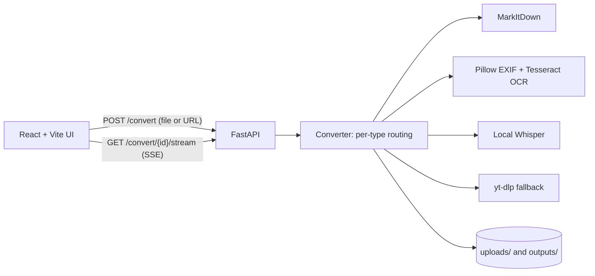

# File to Markdown

Convert files and URLs into clean, structured Markdown. Built on Microsoft's open-source
[MarkItDown](https://github.com/microsoft/markitdown) library, with added OCR, local audio
transcription, and a YouTube transcript fallback.

Drop in a PDF, Word document, spreadsheet, presentation, image, audio or video clip, CSV or JSON,
HTML page, EPUB, or ZIP archive, or paste a URL, and get back a single `.md` file to preview, copy,
or download.

## Features

- **Drag-and-drop upload** with a multi-file queue, file type badges, and size readouts.
- **Per-type conversion routing**:
  - Documents, sheets, slides, data files, archives, EPUB, and HTML: MarkItDown
  - Images: EXIF metadata extraction (Pillow) plus Tesseract OCR
  - Audio and video: local transcription with [Whisper](https://github.com/openai/whisper), no API calls
  - URLs and YouTube links: content and transcript extraction, with a `yt-dlp` fallback for YouTube
- **Live progress** streamed to the browser over Server-Sent Events.
- **Split-pane viewer**: raw Markdown, rendered preview, or both, with syntax-highlighted code blocks.
- **Download or copy** the result, including a "Copy as SPEC.md" mode that wraps the output with
  project scaffolding instructions for a coding agent.
- **Session history sidebar** to reopen earlier conversions.
- **100 MB upload limit** and clear error messages.

## Architecture



The backend accepts an upload or URL, creates a job, and streams `progress`, `result` or `error`,
and `done` events while the converter runs. Jobs are held in memory.

## Tech stack

| Layer | Tools |
|---|---|
| Backend | Python 3.10+, FastAPI, `markitdown[all]`, openai-whisper, pytesseract, Pillow, yt-dlp |
| Frontend | React, Vite, Tailwind CSS, react-markdown, react-syntax-highlighter |
| Storage | Local filesystem (`backend/uploads/`, `backend/outputs/`) |
| Deployment | Docker Compose (backend image includes ffmpeg and tesseract, frontend served by nginx) |

## Getting started

### Prerequisites

- Python 3.10+
- Node.js 18+
- `ffmpeg` for audio and video transcription (`brew install ffmpeg` or `sudo apt install ffmpeg`)
- `tesseract` for image OCR (`brew install tesseract` or `sudo apt install tesseract-ocr`)

Without ffmpeg or tesseract, the related features are skipped and everything else still works.

### Setup

```bash
./setup.sh
```

This creates a Python virtual environment, installs backend dependencies, installs frontend
packages, and reports whether ffmpeg and tesseract were found.

### Run locally

```bash
# Terminal 1: backend on :8000
cd backend
source .venv/bin/activate
uvicorn main:app --reload --port 8000

# Terminal 2: frontend on :5173
cd frontend
npm run dev
```

Open http://localhost:5173. Interactive API docs are at http://localhost:8000/docs.

### Run with Docker

```bash
docker compose up --build
```

Frontend on http://localhost:5173, backend on http://localhost:8000.

### Configuration

| Variable | Where | Default | Purpose |
|---|---|---|---|
| `WHISPER_MODEL` | backend | `base` | Whisper model size (`tiny` to `large`) |
| `VITE_API_BASE` | frontend | `http://localhost:8000` | Backend URL used by the build |

The upload size limit is `MAX_FILE_SIZE_BYTES` in `backend/converter.py`.

## API

| Method | Path | Description |
|---|---|---|
| `POST` | `/convert` | Multipart file upload or JSON `{"url": "..."}`. Returns a job id. |
| `GET` | `/convert/{id}/stream` | SSE stream of conversion progress and result. |
| `GET` | `/convert/{id}` | Result of a finished job. |
| `GET` | `/convert/{id}/download` | Download the generated `.md`, named after the source. |
| `GET` | `/health` | Liveness check and configured size limit. |

```bash
curl -F "file=@report.pdf" http://localhost:8000/convert
curl -N http://localhost:8000/convert/<id>/stream
```

## Project structure

```
backend/
  main.py               FastAPI app, /convert, SSE stream, /health
  converter.py          MarkItDown wrapper and per-type routing
  whisper_transcribe.py Local audio and video transcription
  uploads/, outputs/    Runtime storage (gitignored)
frontend/
  src/components/       DropZone, MarkdownViewer, HistorySidebar, FileTypeBadge
  src/context/          Conversion history state
  src/lib/              API client, file type and SPEC.md helpers
docker-compose.yml
setup.sh
```

## Notes and limitations

- Jobs and history are in memory. Restarting the backend clears jobs.
- The first audio or video conversion is slow while Whisper downloads model weights.
- OCR quality depends on the image and the installed Tesseract language packs (English by default).

## Screenshots

Screenshots coming soon.

## License

MIT. See [LICENSE](LICENSE). MarkItDown, Whisper, and yt-dlp keep their own licenses.
